# Análise de Desempenho por Canal de Vendas — Contoso Retail


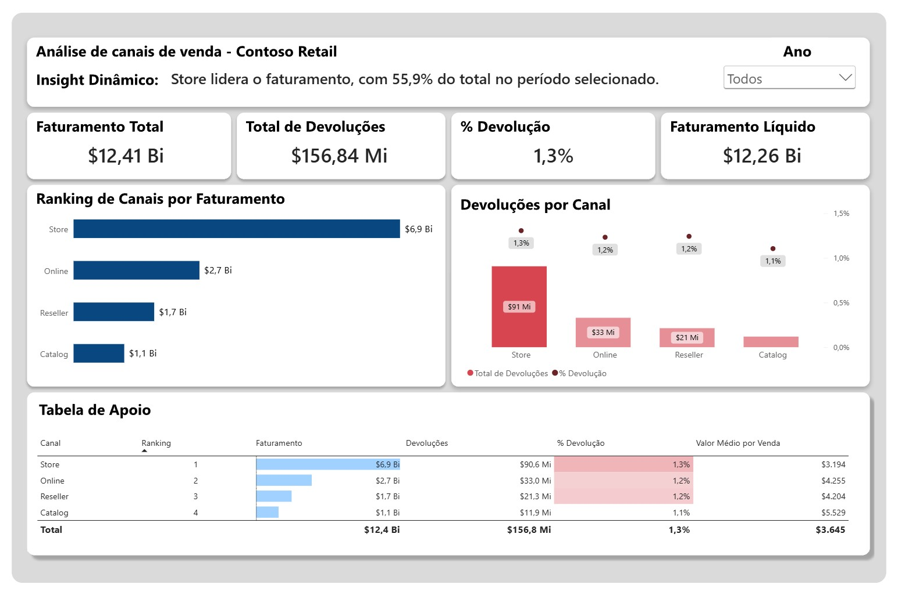

Dashboard em Power BI, construído sobre o ContosoRetailDW (SQL Server), para identificar por qual canal a empresa vende mais e onde as devoluções pesam mais, com filtro por ano e uma frase de insight que se atualiza sozinha.

Principais problemas relatados pelo requisitante:

- Entender por qual canal (Store, Online, Reseller ou Catalog) a empresa vende mais.
- Saber onde estamos perdendo com devoluções.
- Ter um painel simples, de uma página, pronto para a reunião.

[Clique aqui](#7-dashboard) e veja a solução desenvolvida para o cliente.

<br clear="right">

---

## Sumário

1. [Problema de negócio](#1-problema-de-negócio)
2. [Objetivo da análise](#2-objetivo-da-análise)
3. [Ferramentas e tecnologias](#3-ferramentas-e-tecnologias)
4. [Estrutura de dados e modelagem](#4-estrutura-de-dados-e-modelagem)
   - [4.1 Tabelas utilizadas](#41-tabelas-utilizadas)
   - [4.2 Relacionamentos](#42-relacionamentos)
   - [4.3 Modelo no Power BI](#43-modelo-no-power-bi)
5. [Medidas DAX](#5-medidas-dax)
6. [Como reproduzir o projeto](#6-como-reproduzir-o-projeto)
7. [Dashboard](#7-dashboard)
8. [Principais insights](#8-principais-insights)
9. [Conclusão e recomendações](#9-conclusão-e-recomendações)
10. [Limitações](#10-limitações)
11. [Contato](#11-contato)

---

## 1. Problema de negócio

O gestor comercial procurou a área de dados com um pedido direto:

> _"Preciso entender por qual canal a empresa vende mais e onde estamos perdendo com devoluções. Quero ver Store, Online, Reseller e Catalog. Você consegue montar um painel com isso até sexta?"_

A empresa vende por **quatro canais** (Store, Online, Reseller e Catalog) e não tinha uma visão consolidada de quanto cada um fatura e quanto perde em devoluções. Sem esse comparativo, a decisão sobre onde investir orçamento e esforço de qualidade permanecia no campo da incerteza.

## 2. Objetivo da análise

- Gerar o **ranking de canais por faturamento**.
- Medir as **devoluções** (valor e percentual) de cada canal.
- Permitir a leitura por **ano** (2007 a 2009) com um filtro único na página.
- Entregar um painel de **uma página**, legível por um gestor não técnico, com uma conclusão já escrita no topo.

## 3. Ferramentas e tecnologias

| Ferramenta                              | Uso no projeto                                                              |
| --------------------------------------- | --------------------------------------------------------------------------- |
| **SQL Server**                          | Armazenamento dos dados (ContosoRetailDW)                                   |
| **SQL Server Management Studio (SSMS)** | Consultas de exploração e validação dos totais                              |
| **Power BI Desktop**                    | Modelagem, medidas DAX e dashboard                                          |
| **DAX**                                 | Medidas de faturamento, devoluções, percentuais, ranking e insight dinâmico |
| **Figma**                               | Layout usado como tela de fundo do painel                                   |

---

## 4. Estrutura de dados e modelagem

**Base:** `ContosoRetailDW` (base de exemplo da Microsoft). A tabela de fatos `FactSales` tem cerca de **3,4 milhões de linhas**.

### 4.1 Tabelas utilizadas

São seis tabelas: uma de fatos e cinco dimensões.

#### `FactSales` — Fato

Registra as vendas realizadas. **Cada linha é um registro de venda**, que é a granularidade da tabela. É a única tabela de fatos do modelo e guarda os valores que são somados nas medidas.

| Coluna         | O que significa                            | Uso no projeto                  |
| -------------- | ------------------------------------------ | ------------------------------- |
| `SalesKey`     | Identificador único do registro de venda   | Identificação da linha          |
| `DateKey`      | Chave da data da venda                     | Relacionamento com `DimDate`    |
| `channelKey`   | Chave do canal pelo qual a venda foi feita | Relacionamento com `DimChannel` |
| `ProductKey`   | Chave do produto vendido                   | Relacionamento com `DimProduct` |
| `SalesAmount`  | Valor da venda                             | Base do faturamento             |
| `ReturnAmount` | Valor devolvido                            | Base das devoluções             |

#### `DimChannel` — Dimensão

Lista os canais de venda da empresa: Store, Online, Reseller e Catalog.

| Coluna        | O que significa              | Uso no projeto                       |
| ------------- | ---------------------------- | ------------------------------------ |
| `ChannelKey`  | Identificador único do canal | Relacionamento com a `FactSales`     |
| `ChannelName` | Nome do canal                | Eixo dos gráficos e linhas da tabela |

#### `DimDate` — Dimensão

Calendário de datas, que permite analisar as vendas por período.

| Coluna              | O que significa             | Uso no projeto                                  |
| ------------------- | --------------------------- | ----------------------------------------------- |
| `DateKey`           | Identificador único da data | Relacionamento com a `FactSales`                |
| `CalendarYear`      | Ano do calendário           | Filtro de ano do dashboard                      |
| `MonthNumberOfYear` | Número do mês (1 a 12)      | Ordenação cronológica dos meses                 |
| `MonthName`         | Nome do mês                 | Rótulo de mês, ordenado por `MonthNumberOfYear` |

#### `DimProduct` — Dimensão

Cadastro dos produtos vendidos.

| Coluna                  | O que significa                  | Uso no projeto                             |
| ----------------------- | -------------------------------- | ------------------------------------------ |
| `ProductKey`            | Identificador único do produto   | Relacionamento com a `FactSales`           |
| `ProductName`           | Nome do produto                  | Detalhamento por produto                   |
| `ProductSubcategoryKey` | Chave da subcategoria do produto | Relacionamento com `DimProductSubcategory` |

#### `DimProductSubcategory` — Dimensão

Agrupa os produtos em subcategorias.

| Coluna                  | O que significa                     | Uso no projeto                          |
| ----------------------- | ----------------------------------- | --------------------------------------- |
| `ProductSubcategoryKey` | Identificador único da subcategoria | Relacionamento com `DimProduct`         |
| `ProductCategoryKey`    | Chave da categoria da subcategoria  | Relacionamento com `DimProductCategory` |

#### `DimProductCategory` — Dimensão

Nível mais alto da hierarquia de produtos.

| Coluna                | O que significa                  | Uso no projeto                             |
| --------------------- | -------------------------------- | ------------------------------------------ |
| `ProductCategoryKey`  | Identificador único da categoria | Relacionamento com `DimProductSubcategory` |
| `ProductCategoryName` | Nome da categoria                | Análise de devoluções por categoria        |

### 4.2 Relacionamentos

Todos os relacionamentos são **um para muitos (1:N)**: o lado "1" é a dimensão, onde a chave é única, e o lado "N" é a tabela que repete essa chave.

| #   | Lado 1 (dimensão)       | Lado N                  | Chave                       | Cardinalidade | Direção do filtro       |
| --- | ----------------------- | ----------------------- | --------------------------- | ------------- | ----------------------- |
| 1   | `DimChannel`            | `FactSales`             | `ChannelKey` → `channelKey` | 1:N           | Única (dimensão → fato) |
| 2   | `DimDate`               | `FactSales`             | `DateKey` → `DateKey`       | 1:N           | Única                   |
| 3   | `DimProduct`            | `FactSales`             | `ProductKey` → `ProductKey` | 1:N           | Única                   |
| 4   | `DimProductSubcategory` | `DimProduct`            | `ProductSubcategoryKey`     | 1:N           | Única                   |
| 5   | `DimProductCategory`    | `DimProductSubcategory` | `ProductCategoryKey`        | 1:N           | Única                   |

**Diagrama:**

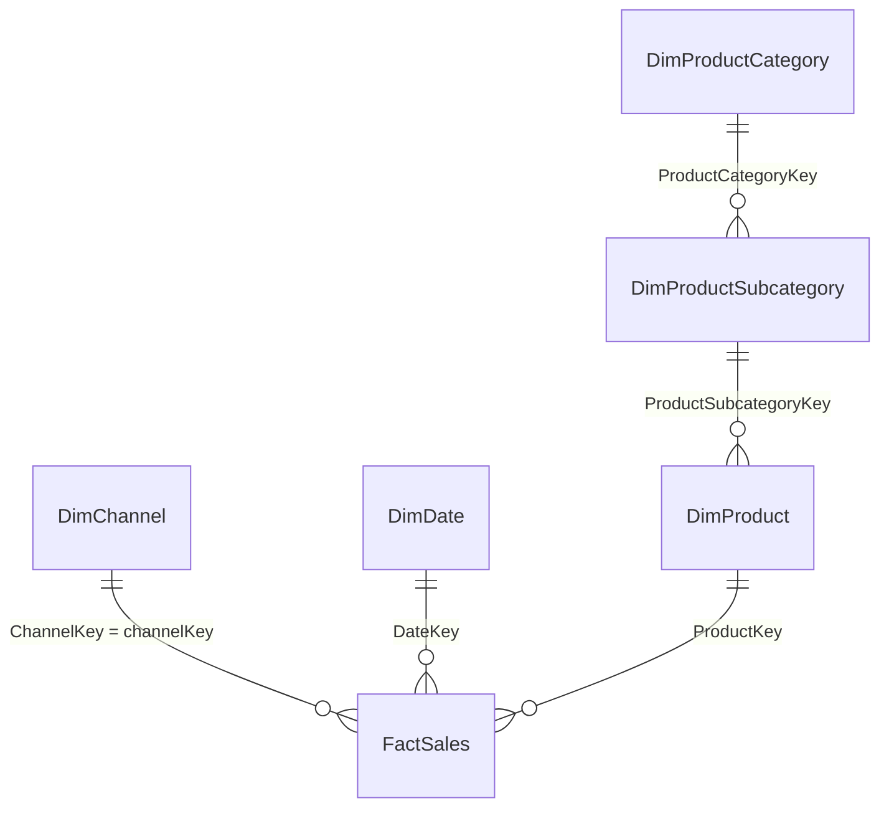

**Caminho do filtro** (sempre do lado "1" para o lado "N"):

```
DimProductCategory ─► DimProductSubcategory ─► DimProduct ─► FactSales
                                                             ▲        ▲
                                              DimChannel ────┘        └──── DimDate
```

Assim, ao filtrar uma categoria de produto, o filtro desce pela subcategoria e pelo produto até chegar às vendas. Os canais e as datas filtram a `FactSales` diretamente.

### 4.3 Modelo no Power BI

O modelo segue o **esquema estrela (star schema)**: a `FactSales` fica no centro e as dimensões ao redor. Cada dimensão filtra o fato, e o fato nunca filtra as dimensões.

**Print 1: Modelo de dados em esquema estrela no Power BI**

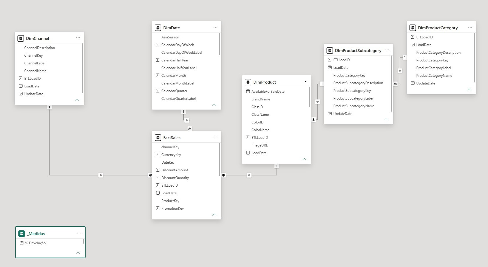

#### Decisões de modelagem

| Decisão                                                   | Por quê                                                                                                                                                                            |
| --------------------------------------------------------- | ---------------------------------------------------------------------------------------------------------------------------------------------------------------------------------- |
| **Importar as tabelas separadas, e não uma query pronta** | Uma query já agregada fixaria o nível de detalhe e o percentual de devolução. Com as tabelas separadas, as medidas DAX recalculam tudo em qualquer filtro (ano, canal, categoria). |
| **Modo Importar (não DirectQuery)**                       | O volume de 3,4 milhões de linhas é bem comprimido pelo Power BI, e o painel responde rápido.                                                                                      |
| **Esquema estrela**                                       | Mantém o fato só com chaves e valores, e as descrições (nomes de canal, mês, categoria) nas dimensões. Reduz tamanho e deixa os filtros previsíveis.                               |
| **Filtro em direção única**                               | Evita ambiguidade entre caminhos de filtro e resultados difíceis de explicar.                                                                                                      |
| **Só colunas necessárias**                                | Menos colunas, principalmente de alta cardinalidade como `SalesKey`, melhoram a compressão e o desempenho.                                                                         |
| **`DimDate` como tabela de datas**                        | Habilita funções de inteligência temporal e o filtro de ano.                                                                                                                       |
| **`MonthName` ordenado por `MonthNumberOfYear`**          | Sem isso os meses aparecem em ordem alfabética.                                                                                                                                    |
| **Chaves ocultas e sem resumo**                           | As colunas de chave e `CalendarYear` ficam como "Não resumir" e ocultas, para ninguém somá-las por engano.                                                                         |
| **Tabela `_Medidas`**                                     | Uma tabela vazia reúne todas as medidas, fica no topo da lista e deixa o modelo organizado.                                                                                        |
| **Hierarquia de produto mantida em três tabelas**         | Funciona e atende à análise por categoria. Uma alternativa futura é achatar as três em uma única tabela de produto.                                                                |

**Validação do modelo:** o total de devoluções do Power BI (**156.839.375,868**) bate com a soma direta na `FactSales`, e nenhum visual mostra linha em branco em canal ou ano, o que indica que não há chaves sem correspondência.

---

## 5. Medidas DAX

Todas as medidas ficam na tabela `_Medidas`. Elas **devem ser criadas na ordem abaixo**, porque algumas chamam outras. Os nomes são citados entre colchetes e precisam ser idênticos.

> **Medida × coluna:** os valores calculados são medidas, e não colunas. Uma medida é recalculada em cada contexto de filtro (canal, ano, linha da tabela), e uma coluna calculada ficaria fixa.

**Print 2: Tabela de medidas `_Medidas` no Power BI**


### 5.1 Faturamento Total


Soma o valor de todas as vendas no contexto atual.

### 5.2 Total de Devoluções

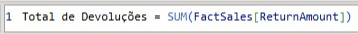

Soma o valor devolvido no contexto atual.

### 5.3 % Devolução

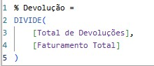

Calcula quanto das vendas foi devolvido, dividindo as devoluções pelo faturamento. Formatada como porcentagem.

### 5.4 Faturamento Líquido


Mostra o que efetivamente ficou na empresa depois das devoluções.

### 5.5 Valor Médio por Venda (Ticket Médio)

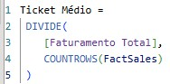

Divide o faturamento pelo número de registros de venda.

### 5.6 Participação do Canal %

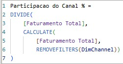

Calcula a fatia do faturamento de cada canal no total de todos os canais.

### 5.7 Ranking do Canal


Dá a posição de cada canal por faturamento, em ordem decrescente (1 = maior).

### 5.8 Canal Líder

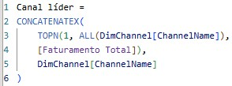

Devolve o nome do canal com maior faturamento.

### 5.9 Insight Dinâmico

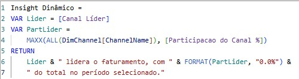

Monta a frase de conclusão do painel, com o canal líder e a sua participação.

### 5.10 Por que essas medidas?

**Por que `DIVIDE` e não o operador `/`?**
A divisão com `/` dá erro quando o denominador é zero ou vazio, e isso acontece quando um filtro deixa um canal sem vendas. O `DIVIDE` devolve vazio nesses casos, e o painel continua funcionando. É o equivalente do `NULLIF` usado no SQL.

**Por que medidas, e não colunas calculadas?**
Uma medida é recalculada conforme o filtro: o mesmo `% Devolução` serve para o total, para cada canal e para cada ano. Uma coluna calculada guardaria um valor fixo por linha, e somar ou fazer média de percentuais já calculados dá resultado errado.

**Por que o percentual é "soma ÷ soma" e não a média dos percentuais?**
A média dos percentuais trata uma venda pequena e uma grande com o mesmo peso. Dividir o total de devoluções pelo total de faturamento dá a taxa real, em qualquer nível de detalhe.

**Por que `CALCULATE` em vez de um `SUM` simples?**
O `SUM` respeita sempre os filtros da tela. O `CALCULATE` permite **mudar** esses filtros para um cálculo específico. Na participação do canal, por exemplo, ele retira o filtro de canal do denominador para obter o total geral, e mantém o filtro de ano. Sem ele, cada canal seria dividido por si mesmo e daria 100%.

**Por que `REMOVEFILTERS` e `ALL`?**
Os dois removem filtros dentro de um cálculo. São usados no denominador da participação e no ranking, para cada canal ser comparado com **todos** os outros, e não só consigo mesmo.

**Por que `VAR`?**
Guarda um resultado em um nome e o reutiliza. Deixa o código mais legível e evita calcular a mesma expressão duas vezes.

**Por que `ISINSCOPE` no ranking?**
Sem ele, a linha de total da tabela mostraria "1", o que não significa nada. Com ele, a linha de total fica em branco.

**Por que uma medida de texto (`Insight Dinâmico`)?**
Uma frase digitada à mão pode ficar errada quando o filtro muda. Como o texto é calculado, o número da conclusão sempre bate com os gráficos.

**Por que reaproveitar medidas dentro de medidas?**
O `Faturamento Líquido` usa `[Faturamento Total]` e `[Total de Devoluções]`. Se a definição de faturamento mudar um dia, basta alterar em um lugar, e todas as medidas derivadas acompanham.

---

## 6. Como reproduzir o projeto

### Pré-requisitos

- SQL Server com a base **ContosoRetailDW** restaurada (exemplo da Microsoft)
- SQL Server Management Studio (ou outro cliente SQL)
- Power BI Desktop

### Passo a passo

**1. Valide os dados no SQL Server.** Confira se a coluna de devoluções tem valores:

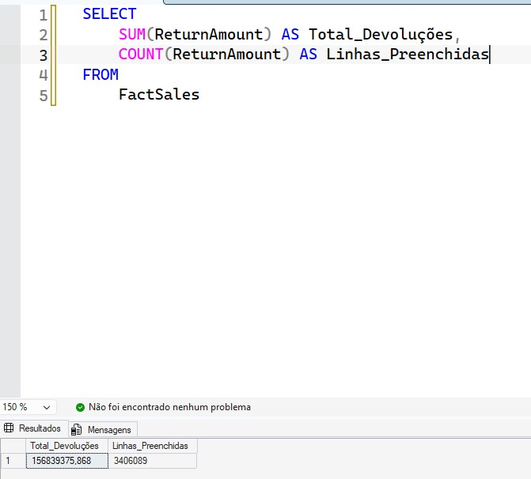

**2. Execute a consulta principal.** Ela reúne, por canal e por ano, o faturamento, as devoluções, o faturamento líquido e o percentual de devolução. O código completo está na pasta [`SQL`](SQL/) do repositório.

**Consulta SQL utilizada**

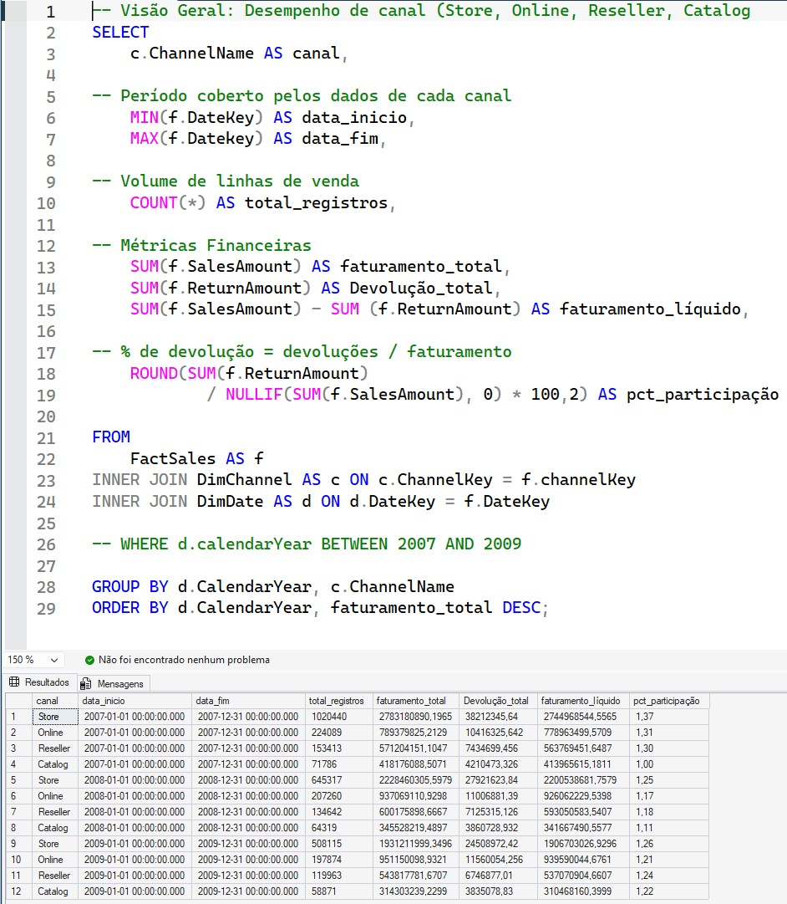

**A lógica, em poucas palavras:**

- **`FROM FactSales`:** parte da tabela de fatos, onde estão todas as vendas e devoluções. Não usa a `FactOnlineSales`, que só tem o canal Online.
- **Dois `INNER JOIN`:** o primeiro troca o código do canal pelo nome (`DimChannel`), e o segundo troca a data pelo ano (`DimDate`).
- **`GROUP BY` ano e canal:** junta as linhas de venda e entrega uma linha por canal em cada ano.
- **`SUM`:** soma o faturamento e as devoluções de cada grupo. O faturamento líquido é a diferença entre as duas somas.
- **% de devolução:** divide o total devolvido pelo total faturado. O `NULLIF` evita erro quando o faturamento é zero, e o cálculo usa a razão das somas, e não a média dos percentuais.
- **`MIN` e `MAX` da data, e `COUNT(*)`:** mostram o período coberto e o volume de registros de cada grupo.
- **`WHERE` comentado:** o filtro de 2007 a 2009 fica desligado porque o `INNER JOIN` já deixa de fora os anos sem vendas.
- **`ORDER BY`:** ordena por ano e, dentro de cada ano, pelo maior faturamento.

> Para ver o total de cada canal em todos os anos, basta tirar `d.CalendarYear` do `GROUP BY` e do `ORDER BY` (e do `SELECT`, se estiver lá).

**3. Conecte o Power BI.** Em _Obter dados → SQL Server_, informe o servidor (quando houver porta, separe com vírgula: `servidor,porta`) e a base `ContosoRetailDW`. Importe as tabelas **separadas**, no modo **Importar**, trazendo apenas as colunas necessárias.

**4. Crie os relacionamentos** conforme a seção [4.2](#42-relacionamentos) e marque `DimDate` como tabela de datas. Ordene `MonthName` por `MonthNumberOfYear`.

**5. Crie a tabela `_Medidas`** (tabela vazia) e adicione as medidas da seção [5](#5-medidas-dax), **nesta ordem**:

1. `Faturamento Total`
2. `Total de Devoluções`
3. `% Devolução`
4. `Faturamento Líquido`
5. `Valor Médio por Venda`
6. `Participação do Canal %`
7. `Ranking do Canal`
8. `Canal Líder`
9. `Insight Dinâmico`

**6. Monte o dashboard** (seção [7](#7-dashboard)). O layout da tela de fundo foi desenhada no Figma e exportado como o arquivo `Página alternativa.svg`. Ele foi aplicado em _Formatar página → Tela de fundo_, e os visuais ficam com o fundo transparente por cima dele.

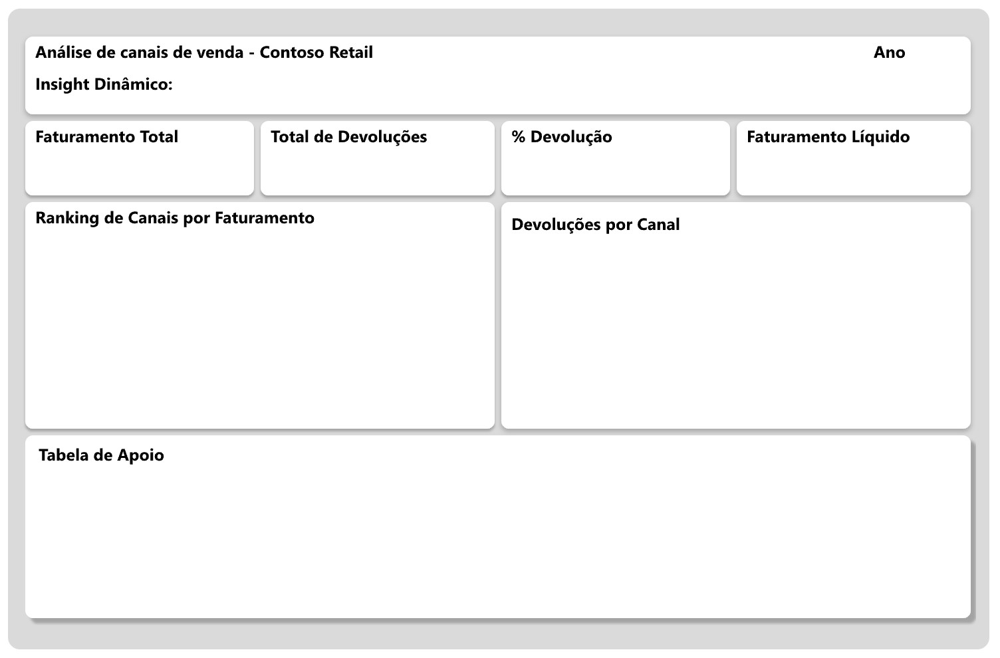

**7. Valide.** Os totais do Power BI devem bater com o SQL:

| Conferência                               | Valor esperado                                     |
| ----------------------------------------- | -------------------------------------------------- |
| Total de devoluções (sem filtro)          | 156.839.375,868                                    |
| Faturamento por canal (filtro em "Todos") | Soma dos anos de cada canal na consulta da etapa 2 |
| Faturamento ao filtrar um ano             | Linhas desse ano na consulta da etapa 2            |
| Soma das participações                    | 100%                                               |

---

## 7. Dashboard

Uma página, com a leitura na ordem **resposta → contexto → causa**: o insight no topo, os totais logo abaixo, o ranking ao lado das devoluções e a tabela de apoio no rodapé.

**Print 3: Dashboard completo, visão geral dos canais de venda**


**Print 4: Ranking de canais por faturamento e devoluções por canal**

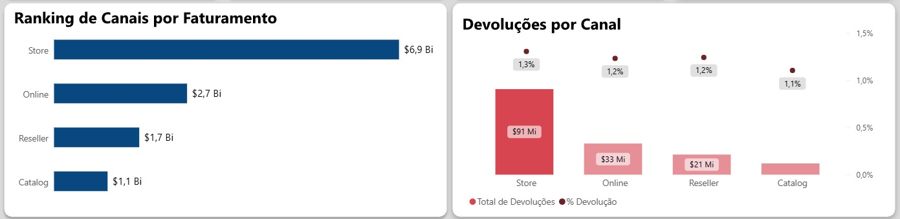

**Print 5: Tabela de apoio com os indicadores por canal**

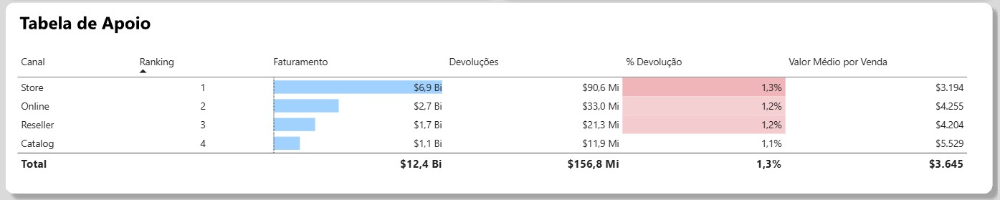

**Print 6: Dashboard com o filtro de ano aplicado**

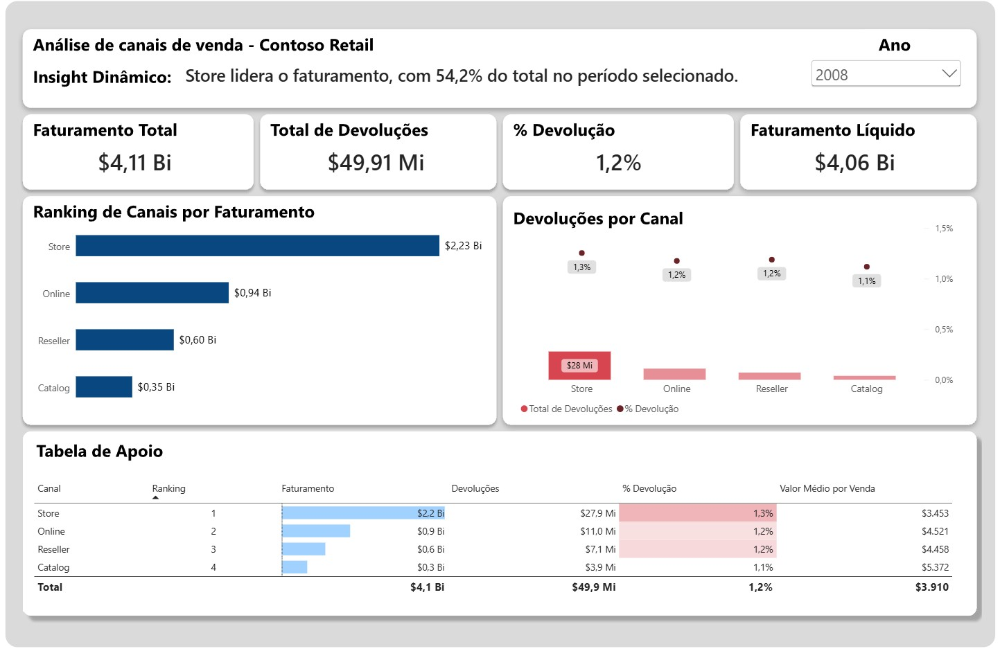

| Bloco      | Visual                                     | Campos                                                                                 |
| ---------- | ------------------------------------------ | -------------------------------------------------------------------------------------- |
| Insight    | Cartão                                     | `Insight Dinâmico`                                                                     |
| Totais     | 4 cartões                                  | `Faturamento Total`, `Total de Devoluções`, `% Devolução`, `Faturamento Líquido`       |
| Ranking    | Barras horizontais                         | `ChannelName` × `Faturamento Total`                                                    |
| Devoluções | Colunas e linha                            | `ChannelName`, `Total de Devoluções`, `% Devolução` (eixo secundário a partir de zero) |
| Apoio      | Tabela com barras de dados e escala de cor | Canal, ranking, faturamento, devoluções, % de devolução, valor médio por venda         |
| Filtro     | Segmentação (lista suspensa)               | `DimDate[CalendarYear]`                                                                |

## 8. Principais insights

Valores exibidos em $, conforme a base Contoso.

| Canal     | Faturamento   | % do total | Devoluções     | % das devoluções | Taxa de devolução | Valor médio por venda |
| --------- | ------------- | ---------- | -------------- | ---------------- | ----------------- | --------------------- |
| **Store** | $6,9 Bi       | **55,9%**  | $90,6 Mi       | 57,8%            | 1,3%              | $3.194                |
| Online    | $2,7 Bi       | 21,6%      | $33,0 Mi       | 21,0%            | 1,2%              | $4.255                |
| Reseller  | $1,7 Bi       | 13,8%      | $21,3 Mi       | 13,6%            | 1,2%              | $4.204                |
| Catalog   | $1,1 Bi       | 8,7%       | $11,9 Mi       | 7,6%             | 1,1%              | $5.529                |
| **Total** | **$12,41 Bi** | 100%       | **$156,84 Mi** | 100%             | **1,3%**          | $3.645                |

> Os percentuais de participação foram calculados a partir dos valores arredondados do painel e podem variar em décimos no Power BI.

### Insights principais

- **A Store é a base do negócio.** Com **$6,9 bilhões (55,9% do faturamento)**, ela vende mais que Online, Reseller e Catalog somados ($5,5 bilhões). Em termos práticos, mais da metade da receita depende de um único canal, e qualquer problema na Store atinge a empresa inteira.
- **As devoluções são baixas.** Somam **$156,84 milhões**, ou **1,3% do faturamento**: a cada $100 vendidos, cerca de $1,30 volta. O faturamento líquido fica em **$12,26 bilhões**.
- **A Store lidera também em devoluções, mas na mesma proporção em que vende.** Ela tem 55,9% do faturamento e **57,8% das devoluções**. O valor devolvido é maior porque o volume vendido é maior, e não porque o canal tenha um problema específico.
- **Nenhum canal foge do padrão.** As taxas de devolução ficam entre **1,1% (Catalog) e 1,3% (Store)**, uma diferença de apenas 0,2 ponto percentual. Os dados não apontam um canal "vilão".
- **Os outros três canais dividem os 44,1% restantes.** O Online é o segundo, com **$2,7 bilhões (21,6%)**, seguido de Reseller (**$1,7 bilhão**, 13,8%) e Catalog (**$1,1 bilhão**, 8,7%).
- **O valor médio por venda varia bastante entre canais.** A Catalog tem **$5.529** por venda, cerca de **73% a mais** que a Store (**$3.194**). A Store vende em volume, e a Catalog vende em valor.

> **Nota:** o "valor médio por venda" é o faturamento dividido pelos registros da `FactSales`, e cada linha é um registro de venda, e não necessariamente um pedido.

### Outros Insights

**Quem vende o maior valor por venda é quem menos devolve.**

A Catalog tem o maior valor médio por venda (**$5.529**) e, ao mesmo tempo, a **menor taxa de devolução (1,1%)**. Costuma-se esperar mais devoluções em compras de valor mais alto, e os dados mostram o contrário. Há ainda um segundo ponto na mesma direção: o **Online**, uma venda à distância, devolve **menos** (1,2%) que a Store física (1,3%).

Os números não explicam o motivo. Podem estar ligados ao perfil dos clientes, ao tipo de produto de cada canal ou à forma como a venda é feita, e é justamente essa a pergunta que o próximo passo da análise precisa responder.

## 9. Conclusão e recomendações

### Conclusão

A empresa depende da Store, e as devoluções são baixas e distribuídas de forma proporcional entre os canais: o canal que mais perde em dinheiro é o que mais vende, e não o que mais devolve. Para o gestor, isso significa que **cortar ou punir um canal por causa de devoluções não se sustenta nos dados**. A decisão mais útil é concentrar o esforço onde o volume está, a Store, porque uma melhoria pequena na taxa, aplicada sobre o maior volume, rende mais do que qualquer ação nos demais canais. Como referência de tamanho, **cada 0,1 ponto percentual a menos na taxa de devolução da Store equivale a cerca de $6,9 milhões** em devoluções evitadas, uma estimativa feita sobre o faturamento do canal. Ao mesmo tempo, o fato de a Catalog, o Reseller e o Online terem valor médio por venda maior e devolução menor abre uma discussão sobre diversificação, que só pode ser concluída com dados de custo e margem, que esta base não traz.

### Recomendações

1. **Priorizar a Store na redução de devoluções.** Como a Store concentra 57,8% das devoluções ($90,6 milhões), é nela que um ajuste de processo, de qualidade ou de política de troca gera o maior retorno. _Simulação ilustrativa:_ se a Store tivesse a taxa da Catalog (1,1%), as devoluções cairiam em cerca de **$14 milhões**. É um cenário hipotético, usado só para dimensionar a oportunidade.
2. **Não reduzir o orçamento de nenhum canal por causa de devoluções.** As taxas ficam entre 1,1% e 1,3% em todos os canais, e esse critério sozinho não justifica uma mudança de investimento.
3. **Acompanhar a taxa de devolução por canal e por ano com uma meta.** Definir com o negócio um limite de alerta para a taxa (hoje em 1,3% no total) e usar o dashboard como rotina de acompanhamento, para identificar cedo qualquer canal que comece a se afastar do padrão.

---

## 10. Limitações

- A base **ContosoRetailDW é um conjunto de dados de exemplo** da Microsoft. As conclusões valem como exercício analítico, e não como fatos de uma empresa real.
- O **valor médio por venda** é o faturamento dividido pelas linhas da `FactSales`, e cada linha é um registro de venda, e não necessariamente um pedido. Por isso o indicador não deve ser lido como "ticket médio de pedido".
- A análise **não inclui custo nem margem**, então mede faturamento e devoluções, e não rentabilidade.
- Os valores estão em **$**, seguindo o padrão da base.

## 11. Contato

**Daniel Francisco Santos**

- LinkedIn: [linkedin.com/in/daniel-santos-996576305](https://www.linkedin.com/in/daniel-santos-996576305)
- GitHub: https://github.com/danielsantos343
- E-mail: danielsantos.krt@gmail.com

---

_Obrigado por chegar até aqui, este é meu primeiro projeto e me sinto muito feliz em publicá-lo após muito esforço. Tem sido uma experiência muito gratificante e desafiadora cada etapa desde a busca do problema até a publicação, mas aqui estou realizando um passo importante na minha transição de carreira. Ficarei muito feliz em ajudar com alguma dúvida._
